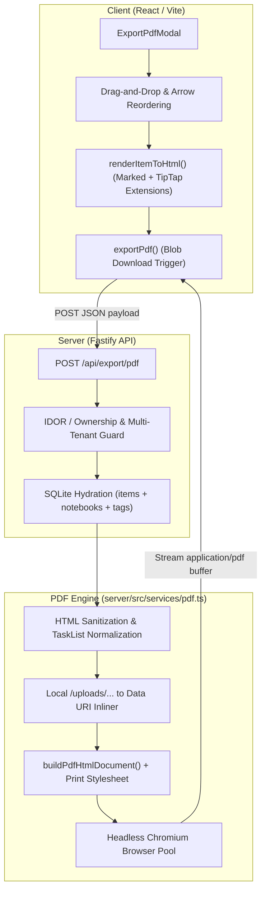
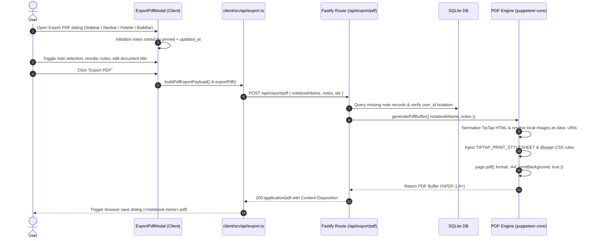

# Architecture Specification: Notebook PDF Export Engine

## Overview
The Notebook PDF Export feature provides server-side rendering of notebooks and selected note collections into paginated, print-ready PDF documents. The pipeline uses headless Chromium (`puppeteer-core`) controlled by Fastify to ensure typography, tables, embedded images, wikilinks, and TipTap interactive task lists render with visual fidelity.

---

## 1. Sequence & Execution Flow

---

## 2. Component Design & Roles

### 2.1 Client UI Layer (`client/src/components/modals/ExportPdfModal.tsx`)
* **State Management:**
  * `orderedNotes`: Array of notebook items maintained in explicit sequence.
  * `selectedIds`: `Set<string>` representing selected items for export (all selected by default).
  * `documentTitle`: Target PDF title and default download filename.
  * `searchQuery`: Non-destructive search filter allowing rapid filtering of large notebooks without resetting order.
* **Reordering Handlers:**
  * HTML5 Drag-and-Drop with `GripVertical` drag handles, drop indicator borders, and ghost suppression.
  * Accessible `ChevronUp` and `ChevronDown` controls with boundary disable states.
  * Real-time sequence badge indicators (`#1`, `#2`, ...).
  * `Reset Order` to restore default sort (pinned first, then newest updated).
* **Triggers Across Application:**
  * **Sidebar:** Hover action button on each notebook item.
  * **Navbar:** Header action button when actively browsing a notebook.
  * **Bulk Action Bar:** Batch action for selected notes across all views (`PDF` button).
  * **Command Palette:** Global action shortcut (`Export Notebook to PDF`).

### 2.2 Client Content Serializer (`client/src/utils/export.ts`)
* Converts varied item types into standardized TipTap-compatible HTML before dispatching:
  * **Markdown / Notes:** Rendered via `Marked` with custom task list tokens and wikilink parsing.
  * **Counters:** Formatted with current value, min/max limits, step size, and unit badge.
  * **Bookmarks:** Rendered with URL, domain, title, and excerpt.
  * **Posters:** Rendered with image thumbnails and caption text.

### 2.3 Server Fastify Endpoint (`server/src/routes/export.ts`)
* Endpoint: `POST /api/export/pdf`
* Ingestion modes supported:
  1. `notes` / `items` array with `{ id, title, html, content, type, metadata, tags }`.
  2. `html` array of formatted HTML strings.
  3. `ids` / `noteIds` array of SQLite note identifiers.
  4. `notebookId` fallback for full notebook generation.
* **Security & IDOR Isolation:**
  * Scoped to authenticated `userId`.
  * Drops unauthorized or missing note IDs (`hasInlinePayload` verification) and returns `400` if no accessible notes remain.

### 2.4 Headless PDF Engine (`server/src/services/pdf.ts`)
* **Browser Lifecycle:**
  * Shared singleton `puppeteer-core` browser instance.
  * Automatic discovery of Chromium / Chrome / Thorium executables across common Linux, macOS, and container paths.
  * Clean teardown registered in Fastify server `SIGINT` / `SIGTERM` handlers via `closePdfBrowser()`.
* **TipTap Invariant & DOM Processing:**
  * Preserves `ul[data-type="taskList"]` and `li[data-type="taskItem"][data-checked]`.
  * Bottom-up reverse DOM traversal for nested task lists to prevent detaching child lists.
  * Sanitization: Strips `<script>`, `<iframe>`, `<object>`, `<embed>`, inline event handlers (`onload`, `onclick`), and blocks outbound external resource requests.
  * Local image resolution: Translates `/uploads/<file>` paths into inline base64 `data:<mime>;base64,...` URIs directly from the local file system.
* **Print Styling:**
  * Media type set to `screen` to honor full CSS styling.
  * `@page` CSS: A4 page format with standard margins (18mm top/bottom, 16mm left/right).
  * Page break controls: `page-break-after: always` between note sections; `break-inside: avoid` on tables, task items, code blocks, and counter summaries.
